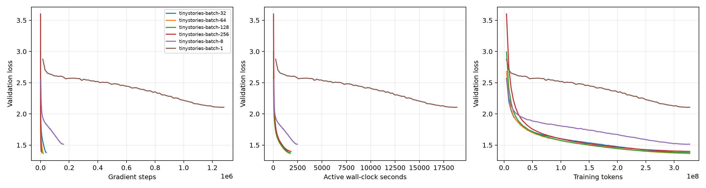

# CS336 Language Model

A byte-level BPE tokenizer and decoder-only Transformer, trained from random initialization on TinyStories. Built on [Stanford CS336 Assignment 1](https://github.com/stanford-cs336/assignment1-basics/tree/a158843b20107949f1a8d7df1b05cd33b9166712), handout **26.0.3**.

The project includes data preparation, resumable training, controlled experiments, text generation, and a KV cache inference extension. Recorded results and reproduction commands are included.

[Project report](docs/showcase.html) · [Experiments](docs/results.md) · [Inference design](docs/inference.md) · [Scope](docs/assignment-status.md)

## Measured results

| Measurement | Result | Scope |
| --- | --- | --- |
| Model | 22,696,448 parameters | 4 layers, width 512, context 256, vocabulary 10,000 |
| Training budget | 327,680,000 tokens per completed run | Random subsequences from the training split |
| Lowest measured final validation loss | **1.3648**, perplexity **3.9149** | Batch 64, peak LR 0.001, one seed |
| Experiment coverage | 18 attempts: 16 completed, 1 diverged, 1 OOM | 6 learning rates, 7 batches, 5 ablations |
| Cached CPU decoding speedup | **2.65× / 4.33× / 6.30×** | Story / engineering / multilingual prompts: 16 / 64 / 128 tokens, 64 new tokens, 4 threads |
| Cached inference correctness | Identical greedy token IDs | Five workloads, 30 timed measurements; maximum prefill logit error 1.57e-5 |

Inference numbers are medians of three paired repeats on an i9-13900HX under WSL2. They measure decoding after the first token; first-token latency did not consistently improve. These are CPU results, not GPU serving measurements. See [inference methodology](docs/inference.md).

The five-case benchmark also covers the context limit: 240 prompt tokens plus 16 new tokens achieves **8.82×** decode speedup without rebuilding, while 248 plus 32 rebuilds the window 23 times and falls to **1.23×**. The earlier three-prefix benchmark is retained separately. The same trained model passed inference-only export and fresh-directory CPU reproduction; see [artifact and reproduction details](docs/delivery.md).



[Experiment analysis](docs/results.md) covers learning-rate selection, batch-size tradeoffs, architectural controls, and failures. OpenWebText experiments remain outstanding; [assignment status](docs/assignment-status.md) separates available evidence from remaining work.

## Setup and checks

Use Linux or WSL: upstream tokenizer tests require Linux resource limits. Python 3.12–3.13 and dependencies are pinned by `uv.lock`.

```bash
uv sync --frozen
uv run --frozen python -m pytest -q
uv run --frozen ruff check cs336_basics scripts tests
```

Verified on 2026-10-26 with Python 3.13.16 and PyTorch 2.11.0: **103 passed, 1 xpassed**, exit code 0. The xpass is an upstream non-strict expected-failure tokenizer memory test. Coverage includes upstream snapshots, incremental BPE versus full recounting, validation sampling, exact checkpoint/resume recovery, cache masking/RoPE offsets, request isolation, EOS and window rebuilds.

## Rebuild experiment reports

No GPU, dataset download or checkpoint is required to rebuild training curves:

```bash
uv run --frozen --with matplotlib python -m scripts.report_experiments \
  --bundle benchmarks/tinystories/measurements.json --phase batch \
  --output-dir results/rebuilt-batch --plot
```

Use `--phase lr` or `--phase ablation` with fresh output directories for other reports. Ablations reuse the measured batch-32 control. `measurements.json` contains every recorded metric, configuration and status; [provenance](benchmarks/tinystories/provenance.json) includes data/source fingerprints and log-recovery details. There are no interpolated measurements.

## Train and generate

Follow [the experiment guide](docs/experiments.md) to download upstream datasets, train the tokenizer, encode separate splits, inspect plans and launch training. Commands plan jobs by default; `--execute` starts them. Resource probes and formal training have separate memory limits.

Generate using a locally trained checkpoint:

```bash
uv run --frozen python -m scripts.generate \
  --checkpoint runs/a1-batch/tinystories-batch-64/checkpoint.pt \
  --vocab results/tinystories-train/vocab.pkl \
  --merges results/tinystories-train/merges.pkl \
  --prompt "Once upon a time" --max-new-tokens 256 \
  --temperature 0.8 --top-p 0.9 --kv-cache \
  --output results/sample.json
```

The [recorded sample](benchmarks/tinystories/sample.txt) ends at EOS after 150 new tokens. It has grammatical English but narrative inconsistencies; a single sample and low perplexity do not establish general language quality. Large datasets and checkpoints are excluded from Git; weights are not downloadable from this repository.

## Layout

| Path | Purpose |
| --- | --- |
| `cs336_basics/` | BPE, tokenizer, Transformer, optimizer, training and inference |
| `scripts/` | Data preparation, experiment execution, generation and reporting |
| `experiments/a1.json` | Pinned specification and default experiment grid |
| `benchmarks/tinystories/` | Training records, curves, sample and provenance |
| `benchmarks/kv-cache/` | Raw paired inference measurements |
| `benchmarks/sgd/` | Handout SGD learning-rate observations |
| `docs/` | Analysis, reproduction, inference design and accounting |
| `tests/` | Upstream tests and supplementary correctness checks |

Core components use explicit PyTorch tensor operations: RMSNorm, RoPE, causal multi-head attention, SwiGLU, cross-entropy, AdamW and gradient clipping. The KV cache uses existing model parameters and checkpoint keys, with no serving framework or external API dependency.

## Sources

Course materials and tests originate from Stanford CS336. Dataset: [TinyStories](https://huggingface.co/datasets/roneneldan/TinyStories). Upstream notices and [LICENSE](LICENSE) are retained. See [resource accounting](docs/accounting.md) for analytical assumptions.
