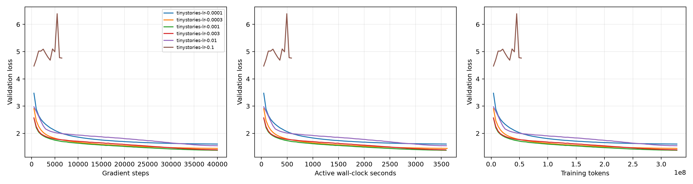
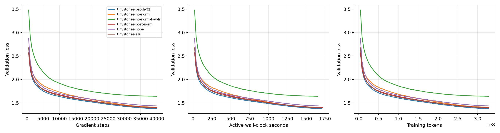

# TinyStories experiments

## Protocol

All completed runs process **327,680,000 training tokens**, with context 256, FP32 (`highest`, TF32 disabled), AdamW, gradient clipping at 1.0, cosine decay to 10% of peak LR, 1% warmup and seed 336. The model has four layers, width 512, 16 heads, vocabulary 10,000 and SwiGLU width 1344: 22,696,448 parameters with untied embeddings.

The encoded training split has 541,229,086 tokens; validation has 5,465,880. Training samples subsequences with replacement. A 327.68M-token budget is not a complete traversal of the training split. BPE was trained on training text only. See [data hashes and configurations](../benchmarks/tinystories/provenance.json).

LR experiments used an RTX 4080 SUPER instance; batch and architecture experiments used an RTX 5090 D. Names come from actual device queries. Times across these phases are not a controlled hardware comparison.

## Learning rate

| Peak LR | Final validation loss | Status |
| --- | ---: | --- |
| 0.0001 | 1.60735 | Completed |
| 0.0003 | 1.44724 | Completed |
| 0.001 | **1.37919** | Completed |
| 0.003 | 1.39466 | Completed |
| 0.01 | 1.54650 | Completed |
| 0.1 | 4.76331 at last validation | Diverged after step 6500 |

Peak LR 0.001 gave the lowest final held-out loss among these candidates and was carried into subsequent experiments. LR 0.1 stopped when clipping detected a nonfinite gradient norm; its last finite loss is not a full-budget result. Lower rates converged more slowly; a larger stable rate did not necessarily improve final loss.

## Batch size at a fixed token budget

| Physical batch | Updates | Final validation loss | Perplexity | Training loop minutes |
| ---: | ---: | ---: | ---: | ---: |
| 1 | 1,280,000 | 2.10739 | 8.22673 | 313.99 |
| 8 | 160,000 | 1.51494 | 4.54914 | 41.06 |
| 32 | 40,000 | 1.37888 | 3.97044 | 28.49 |
| 64 | 20,000 | **1.36480** | **3.91495** | 28.65 |
| 128 | 10,000 | 1.37483 | 3.95439 | 29.38 |
| 256 | 5,000 | 1.39947 | 4.05307 | 30.12 |
| 320 | — | — | — | OOM before metrics |

Comparing equal update counts would give different batches different amounts of training text. The token axis controls that budget. Validation uses the same 20 batches of 32 sequences with a reset sampling seed. Logging/evaluation/checkpoint intervals scale inversely with training batch size, with integer rounding.

Batch 64 is best under this **fixed peak LR 0.001 and one seed**, not universally best. Batches 1 and 8 require a separate LR sweep before attributing their worse loss to batch size itself. The batch-32/64 difference is small and has no multi-seed uncertainty estimate.

Throughput plateaus around batch 32 for this model/hardware. Batch 1 performs many small updates and takes much longer. Larger batches reduce update count but do not improve time indefinitely. Formal batch 320 failed despite fitting an earlier short synthetic probe. The largest completed physical batch is 256; the precise memory limit and probe/training discrepancy remain unestablished.

## Architecture ablations

All use batch 32 and 40,000 updates. The measured batch-32 control is reused rather than replaced with the better batch-64 result.

| Architecture | Peak LR | Final validation loss | Difference from control |
| --- | ---: | ---: | ---: |
| Pre-norm + RoPE + SwiGLU | 0.001 | **1.37888** | — |
| Remove all RMSNorms | 0.001 | 1.41033 | +0.03146 |
| Remove all RMSNorms | 0.0001 | 1.64151 | +0.26263 |
| Post-norm | 0.001 | 1.39968 | +0.02080 |
| No positional embeddings | 0.001 | 1.43616 | +0.05728 |
| SiLU FFN, width 2048 | 0.001 | 1.39265 | +0.01378 |

Both no-norm rates remain stable; lowering LR tenfold worsens final loss at this budget. There is no observed no-norm divergence to report. Pre-norm slightly outperforms post-norm here. Removing RoPE produces the largest loss increase among single architecture changes at LR 0.001. Two-matrix SiLU approximately matches three-matrix SwiGLU FFN parameters (2048 versus 1344 hidden width) and slightly worsens loss. These observations are not statistically significant rankings or proofs about all language models.

## Tokenizer and generation

Full TinyStories BPE produced 10,000 entries and 9,743 merges in **744.88 seconds**, with process peak **10,910.74 MiB**. Adjacent-pair counts update only for affected pre-tokens with deterministic tie breaking; tests compare against full recounting. There is no matched full-corpus baseline supporting a numeric speedup claim.

A validation-prefix probe encoded 200,088 UTF-8 bytes into 48,812 tokens (4.099 bytes/token) at approximately 0.512 MB/s, with exact round-trip. It is a short probe, not the full official ten-document/cross-corpus comparison.

The [saved generation](../benchmarks/tinystories/generation.json) uses the batch-64 checkpoint, prompt `Once upon a time`, temperature 0.8, top-p 0.9, seed 336, and stops at EOS after 150 tokens. Sentences are mostly fluent, but a picture becomes a live injured cat and “It was not a cat anymore” contradicts the story. Local next-token prediction does not ensure narrative consistency. Training budget/model capacity can change learned distributions; temperature/top-p change diversity and coherence. Neither improvement is established by a single sample.

## Evidence and limitations

The bundle contains **18 attempts: 16 completed, one OOM and one divergent run**, with 13,125 metric records. The batch-32 control appears in two plots but counts once. Missing/truncated JSONL records were recovered from intact console logs: 1,923 in LR and 4,195 in batch experiments. Recovery checked step/token sequences, validation cadence, final results and checkpoint iterations, preserving originals and writing separate derived records. The truncation cause remains unknown.

[Provenance](../benchmarks/tinystories/provenance.json) records source/metric/archive hashes and recovery counts. Historical training source fingerprints differ from the current inference extension; inference measurements are a separate experiment. No curves are interpolated. Perplexity is `exp(mean token NLL)` on sampled validation sequences; there is no untouched final test set or task-specific quality evaluation. OpenWebText, batch-specific LR retuning and repeated seeds remain separate work.
